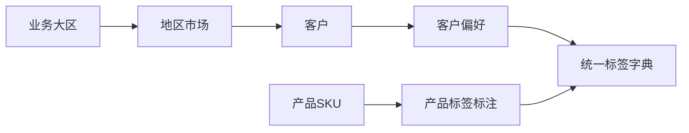

# 市场、客户偏好与产品标签

当前实施状态见 [V3当前结构](V3_CURRENT.md)。地区市场、业务负责人、两个已确认客户及标签字典已配置；
客户偏好、产品标签和历史订单对应客户仍需根据真实业务资料维护。
详见 [导入执行记录](../operations/2026-10-20-order-import.md)。用户确认的大区为欧洲、东南亚、南美。
这里统一称为“业务大区”，以实际管理口径组织地区市场。

## 市场与客户

| 对象 | 保存内容 | 关系与规则 |
| --- | --- | --- |
| 业务大区 | 编码、名称、启用状态 | 当前欧洲、东南亚、南美 |
| 地区市场 | 编码、名称、所属大区、负责人 | 一个市场归属一个大区；归属未知先待核对 |
| 客户档案 | 客户编码、名称、经营市场、负责人、合作状态 | 一个市场有多个客户；若同一客户经营多个市场，复用档案 |
| 客户偏好 | 客户、标签、方向、程度、适用市场/品类、依据、核实日期、有效期 | 一个客户可有多个偏好，不从市场批量继承 |
| 产品标签 | SKU、标签、核实状态、依据、维护人、核实日期 | 一个SKU可有多个标签；不能据客户偏好反向生成产品事实 |

示意：欧洲 → 波兰 → 客户A/客户B；南美 → 巴西 → 客户C。
客户A/B/C是合成示例，不是真实客户，也未写入数据库。

源文件的市场标签保留原文，业务大区归属另行确认。已有香港工作表不能强行归入东南亚；
暂留大区待核对，不为凑齐三个大区而错误归类，也不擅自新增第四大区。

客户档案不等同业务渠道。原表没有确认客户时可留空；不把地区市场或负责人当作客户名称。
同名客户不自动合并，跨市场同一客户的身份需核对。

## 订单如何关联

渠道订单批次保留原渠道下单编号，主单可填默认客户、默认市场，方便录入。
**SKU明细保存实际客户与地区市场**，由市场查到大区。已确认明细不会随主单默认值改变而回写。
若同批次同SKU涉及不同客户或市场，拆为不同明细，计划及实际提货分配仍关联各自明细。
统计按明细基础数量汇总，不能把整批数量分别重复计给每个客户。

客户已知时，订单市场必须在客户经营市场内；未知归属进入待核对组，不丢弃数量。
历史订单仍按其记录的地区市场统计，不能因客户后来扩展经营市场而自动重分类。

## 标签字典

标签不是任意输入的自由文字。每个标签保存稳定编码、规范名称、分类、定义、别名、适用对象和启用状态。
产品主品类继续单独保留，如键盘、鼠标；标签描述可交叉筛选的定位、功能和外观。

| 分类 | 候选标签示例 | 标注要求 |
| --- | --- | --- |
| 产品定位 | 性价比 | 说明比较范围、目标客群与判断依据；不能等同低价 |
| 灯效外观 | RGB灯效、简约外观 | RGB须核对规格或实测；外观判断需明确标准 |
| 连接方式 | 无线连接 | 具体协议、连接数量等仍放结构化规格字段 |

这些仅是候选词汇，不代表任何实际SKU已经具备这些特点。
统一“RGB灯效”和“RGB”等同义词，避免重复标签。
型号相似、客户喜欢某特点或备注提到某词，都不足以自动标注整系列SKU。
精确价格、尺寸、接口、轴体和箱规应保留独立规格/价格字段，不靠标签替代。

## 客户偏好的表达

| 项目 | 内容 |
| --- | --- |
| 偏好方向 | 偏好 / 必须具备 / 避开 |
| 重要程度 | 高 / 中 / 低 |
| 适用市场 | 可限定一个经营市场，空表示该客户全部经营市场 |
| 适用品类 | 可限定键盘等品类，空表示全品类 |
| 依据 | 客户反馈、业务观察、历史订单等；推测注明待核实 |
| 时间与状态 | 核实日期、有效期、待核实/有效/已替代/已失效 |

合成示例：客户A在波兰的键盘采购偏好“性价比（高）”“RGB灯效（中）”；
客户B在相同市场可能“避开RGB灯效”。不能因为地区相同而复制偏好。
偏好不是永久属性，修改时保留历史；同客户、市场范围、品类范围、标签在同一时点只保留一个有效版本。
通用偏好与特定市场/品类偏好矛盾时提示人工核对，不隐式覆盖。
未记录不代表不喜欢；产品未标注某特点也不代表一定不具备。

## 面向业务的查询

- 从欧洲进入波兰，查看该市场客户、偏好和关联订单。
- 查看某客户在键盘品类下必须具备、偏好和避开的特点。
- 筛选同时具备已确认“性价比”和“RGB灯效”标签的键盘SKU，供业务选品。
- 检查产品标注待核实、客户偏好过期以及市场归属缺失的记录。

这些是待实现的视图需求，不是已部署的查询页面或推荐算法。
标签交集只能找候选，不能据此宣称规格、报价、库存或交付条件已经匹配。

## 迁移与实现

原品类标签保留为来源证据，经核对后映射统一标签字典；不要丢弃旧标记，也不要直接生成客户偏好。
原文件缺失的客户和偏好由后续业务维护，不生成虚构资料。
实现时需校验市场归属、客户经营范围、标签适用对象、有效期、重复有效偏好和产品核实状态。
当前生成器仅验证结构与链接，尚未实现这些线上写入约束。
