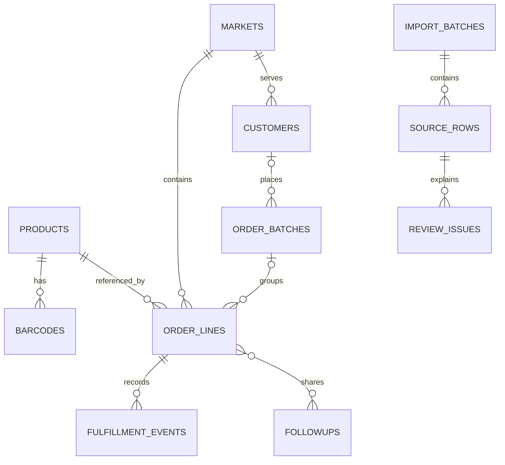

# 外设产品与渠道订单结构

当前建议版本：**[V2模型说明](V2_MODEL.md)**、[V2字段字典](V2_FIELD_DICTIONARY.md)、
[机器可读模型](../../schema/teable-model-v2.json)。基础表与七个市场历史台账已部署；
派生字段、受控过账和正式业务归属仍待实施/核对。详见 [导入执行记录](../operations/2026-10-20-order-import.md)。

V2.1新增 [业务大区、地区市场、客户偏好与产品标签](MARKETS_AND_TAGS.md)：
欧洲/东南亚/南美下设地区市场，市场关联客户；统一标签字典分别记录客户偏好与产品特点。

用户已确认：订单批次是业务渠道下单编号，一个批次可跨月、包含多个SKU，实际提货时间不固定。
因此主线调整为：**业务渠道 → 订单批次 → SKU明细 → 分月计划**；实际提货单及履约分配另行登记。
改期不会新建订单，计划量不会重复加到下单量，待提交基地预测不代表渠道尚未下单。

V2参考ERPNext订单/分批交货、Odoo分阶段流程和GS1包装编码，补充分单、数量变更、余量关闭、
退回和冲销的规则。文档中的规则仍需在实施时落实，不能把逻辑草案当作已运行的业务控制。

## 以下为V1来源审查与历史方案

保留原文件分析证据。下面的旧表划分、状态及“原行即订单明细”假设已由V2替代，不作为建表依据。

状态：**供审阅，尚未创建业务表或导入数据**。依据用户于2026-10-20提供的两份Excel，版本 `draft-2026-10-20-v1`。

## 已确认的业务定义

用户已确认：订单表原来的“已发货”表示**渠道业务已经从基地或仓库提走的数量**。
新结构统一用“已提货”，原来的“待发货”相应改为“待提货”。
国际发运、客户签收是不同环节，不能通过“已提货”推断。原始Excel不改动，导入映射保留旧列名。

## 主要表和关联

所有市场的订单进入同一张明细表，通过市场字段和视图筛选。产品档案按正式料号区分SKU，
不同颜色、轴体、语言版本只要料号不同，就保留为不同SKU，不根据相似型号名称合并。

| 表 | 一行代表什么 | 第一阶段用途 |
| --- | --- | --- |
| 产品档案 | 一个品牌下的一个正式料号 | 统一产品资料；型号和料号分开 |
| 条码台账 | 一个国家/包装/预留编码的分配 | 支持同一料号多个历史EAN，不覆盖旧码 |
| 市场 | 一个销售市场 | 保存原SA/SEA/EU分组，不把市场当客户 |
| 客户 | 一个经确认的客户公司 | 源文件无独立客户列，可先空表 |
| 订单批次 | 一个经确认的PO/PI或业务批次 | 不能用Excel序号、空批次或料号编造订单号 |
| 订单明细 | 一条需求/预测/订单排期行 | 保留初始96条记录，后续再确认订单归并 |
| 提货及交付记录 | 一次明确的提货、退回、发运或签收事件 | 支持分批发生，按类型分别累计 |
| 跟进记录 | 一次业务备注或历史文字记录 | 月度备注和共享合并区域不再互相覆盖 |

另有三张管理表：**导入批次、来源行、待核对事项**，用于追溯、重复导入控制和数据修正。
第二阶段再加入**USB PID台账**，保留已有69条型号级用途记录，避免只凭型号名错误关联SKU。

产品、市场到订单的正式链接在导入核对后建立；图中的产品业务规则不表示待核对行已被强制关联。
双方链接应使用同一对正反向字段，不重复创建两套互不关联的链接。

## 从文件得到的依据

### 产品主数据

来源：`雷神全品类料号69码总表+机械师外设料号69码.xlsx`。

| 工作表 | 业务数据起点 | 识别出的已填写产品行 |
| --- | --- | ---: |
| 雷神全品类-2017前 | 第3行 | 275 |
| 雷神全品类-2017后 | 第3行 | 1,018 |
| 雷神全品类-2021后 | 第5行 | 3,123 |
| 机械师外设 | 第2行 | 1,137 |

这些是**源行数，不是去重后的SKU数**。共识别5,553条有料号或描述的产品源行，
其中423行没有可用正式料号（包含“保留”占位）；另有413条只有条码/条码公式的预留行。
清理首尾空白、统一ASCII字母大小写并排除占位后，共5,128个候选料号，其中1个含疑似混用字符，需核对。

- 两组“同品牌同料号、多个EAN”需要保留全部分配记录，并确认当前首选码。
- 127条已填写产品行的EAN是没有缓存结果的公式，尚不能得到其最终条码。
  需在Excel中对工作副本重新计算后核对，不能生成猜测值或把公式字符串导入EAN。
- 另外6条已给出文字/数字的EAN未通过EAN-13检查，单独待核对；与公式未计算是两种问题。
- 雷神新表有8行同时标了多个品类/业务属性。完整保留源标签，主品类另行确认。
- `产品PID前期汇总`按型号记录，不能直接当作料号主数据；PID的`0`不能当空值。
- 隐藏的非业务/凭据页及登录说明不进入业务表、设计附件或GitHub。

### 订单需求

来源：`外设海外订单统计(每月对指标用)-r261010.xlsx`，首行为表头，从第2行起识别业务明细。

| 市场工作表 | 明细行数 |
| --- | ---: |
| 巴西 (SA) | 25 |
| 阿根廷 (SA) | 3 |
| 菲律宾 (SEA) | 23 |
| 越南 (SEA) | 19 |
| 香港 (SEA) | 6 |
| 土耳其 (EU) | 9 |
| 波兰 (EU) | 11 |
| **合计** | **96** |

96行涉及58个料号，均可在产品源数据中精确找到料号。
其中1行原品牌与产品档案品牌不一致，链接确认前需核对，不能默默改写任何一方。
源表有23行“已完结”，其中22行仍显示待提货数量大于零。保留源数量和状态，进入核对清单。
96行缓存数量均符合 `数量 = 已提货 + 待提货`，但算术成立不能证明业务数量已更新。

- 47行无批次描述，29行无下单日期，11行无计划交付日期。
- 46行原EAN缺失，不影响精确料号匹配；同料号多码时仍不能擅自补一个EAN。
- 源表“序号”存在重复，同一料号也多次出现，均不适合作为订单主键。
- 原状态含“待提交预测”，因此这96行不是96笔已确认订单。需求/预测/确认订单要单独区分。
- 原表没有独立客户公司、PO/PI、币种、单价或可靠金额字段，不能从备注中的金额文字推算销售额。

## 数量和日期规则

1. 初次导入保留 `原表已提货` 和 `原表待提货`，对应原M、N列，作为历史快照。
2. 核对后填写 `期初已提货确认数` 和 `期初截点`。确认前，新的权威已提货/待提货字段保持空值并显示待核对，
   不把未知强制写成零；原始快照视图仍能使用。
3. 截点之后新建提货事件。已确认且未作废的基地提货增加已提货数；退回基地减少该数。
   国际发运、客户签收对提货数贡献为零，分别用于后续物流跟踪。
4. `已提货 = 经确认期初已提货 + 截点后提货净增量`；`待提货 = 数量 - 已提货`。
   负数必须报警，不能用取零掩盖超提或数据错误。取消/改单需经过明确数量变更及审计。
5. 计划交付日期、下单日期、预测提交日期和实际事件日期分别保存。
   月度计划使用计划交付日期，实际提货统计使用提货发生日期，客户交付统计使用签收日期。
   未排期记录单列，不能按导入月份补齐。

这些是待实施的业务规则，尚未配置或验证Teable公式、汇总和权限。

## 第一阶段页面

- **产品档案**：按品牌、主品类和细分品类查看；通过料号搜索对应EAN。
- **全部需求及订单**：按市场和业务进度分组，保留源状态及核对状态。
- **待提货**：只展示已确认期初、待提货量大于零的明细；未确认的历史记录留在核对视图。
- **计划交付月度**：所有市场放在同一表，按年份月份分组，替代不断增加的“10月/11月”列。
- **仅确认订单**：和需求、预测分开，避免把预测数量当作已签订单。
- **提货及交付记录**：明细下查看每次流转、凭据、日期和数量。
- **待核对**：集中处理EAN、品牌、历史数量与状态等冲突。

## 导入顺序和边界

1. 保存受限源文件、文件哈希和映射版本；排除隐藏凭据页及非业务说明。
2. 按白名单列提取来源行，保留单元格类型、公式/缓存和共享合并区域信息。
3. 建立市场、正式SKU和条码台账。预留、缺料号、公式待计算的记录保持原状进入隔离区。
4. 保留全部96条订单需求行，只在料号和品牌一致且无歧义时确认产品链接。
   空批次、重复序号和相同SKU不同排期不自动合并。
5. 迁移O/P列和R/S/T各表的业务备注。合并区域只生成一条共享跟进记录并关联涉及的明细，
   不无差别向下填充所有空单元格。
6. 确认期初数及截点后，启用新提货记录和汇总公式。历史散文不自动转换为有精确数量/日期的事件。
7. 同一文件重复导入按 `文件SHA256 + 工作表 + 行号` 去重。
   文件内容变化后的新版本先按已确认的业务ID对账，不能直接追加成一批新订单。

只通过Teable UI/API创建业务表、字段和链接，不直接在应用数据库中执行独立建表SQL。
当前JSON是逻辑设计合同，不是可直接调用Teable的请求体，也不会执行任何迁移。

## 尚待业务确认

- 原K列“计划交付时间”通常指预计提货还是预计客户交付？目前保留原名称，不替换成提货日期。
- “备品”中`0.02`是否代表2%的备品比例？来源包含文字“无”和数值，暂按原文保留。
- 正式客户名和PO/PI是否有另一份来源？当前允许批次/客户链接暂缺，不从市场标签编造。
- 历史源状态和提货数量由谁核对，期初截点定在哪一天？未确认前不将旧快照包装成可靠实时进度。

详细字段见 [字段字典](FIELD_DICTIONARY.md)，机器可读草案见 [teable-design.json](../../schema/teable-design.json)。
提取与预检脚本位于 `tools/schema/`；完整源数据画像仅保存在仓库外的本地分析目录，不上传GitHub。

## 来源与复核

- 两份原始Excel保持不变。分析结果仅代表本次文件快照，不代表实时订单系统。
- 料号/EAN、订单数量和原状态的证据均可由对应文件、工作表和行号回溯。
- [Teable数据库与导入说明](https://help.teable.ai/zh/basic/base/base)。
- [Teable系统创建时间说明](https://help.teable.ai/zh/basic/field/advanced/created-time)：导入创建时间不是历史业务日期。
