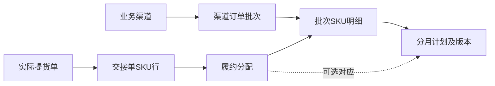

# 渠道订单与提货模型 V2

状态：**研究修订草案，尚未在Teable中实施**。本版替代V1作为后续建模依据。
本次只修改设计、映射说明和验证样例，不改线上服务、不建业务表、不导入原始Excel。

V2.1新增 **业务大区 → 地区市场 → 客户**，并将客户偏好与产品标签纳入一期。
详见 [市场、客户偏好与产品标签](MARKETS_AND_TAGS.md)；目前大区为欧洲、东南亚、南美。
订单主单可预填客户/市场，实际归属保存在SKU明细，支持同批次不同客户或市场的明细。

## 采用的成熟模型

以ERPNext的订单和履约单据划分为主要参考，结合Odoo分阶段仓库流程和GS1包装编码规则。
这是对公开模式的适配，**不是导入了这些ERP的现成数据库，也不表示Teable已具备其事务控制能力**。

| 参考 | 核心模式 | 本项目采用方式 |
| --- | --- | --- |
| [ERPNext Sales Order](https://docs.frappe.io/erpnext/sales-order) | 订单确认的是客户承诺，订单与实际履约分开 | 渠道订单批次为主单，SKU明细记录订单数量 |
| [ERPNext Delivery Note](https://docs.frappe.io/erpnext/delivery-note) | 交货凭据有明细，订单可分多次履约 | 提货单＋SKU交接行，支持不定时分批提货 |
| [ERPNext Close Sales Order](https://docs.frappe.io/erpnext/close-sales-order) | 可以结束未履约余量，同时保留已发生交易 | 关闭余量单独记量，不篡改实际提货数 |
| [ERPNext Item Variants](https://docs.frappe.io/erpnext/item-variants) | 交易SKU与型号/模板分开 | 订单只关联正式SKU，型号系列归并可后做 |
| [Odoo Routes](https://www.odoo.com/documentation/19.0/applications/inventory_and_mrp/inventory/shipping_receiving/daily_operations/use_routes.html) | 仓库作业有多个阶段 | 基地交接、海外发运、客户签收不能共用一个已完成标记 |
| [GS1 Pack/case quantity](https://www.gs1.org/1/gtinrules/en/rule/270/packcase-quantity) | 包装层级、装量变化需要对应编码管理 | SKU、包装规格、条码分配分别记录 |

GS1对包装装量变化的要求不能简化成“一个SKU随便挂多个当前EAN”。同料号多码需要确认
究竟是不同包装、编码主体或历史问题；V2保留这些情况为待核对，不自动解释为历史版本。

## 用户已确认的核心业务

1. **订单批次是业务渠道下单的编号**。同一批次可以包含多个SKU，跨越多个月份。
2. **提货时间不固定**。计划是可变的，实际交接发生后才有实际提货时间。
3. **已提货**是渠道业务从基地/仓库提走的数量；并不代表海外客户已收货。

因此，日期/月份不能参与订单批次的身份；不能一改月份就再创建一笔订单。
原表“待提交预测”也不能直接解释为“渠道尚未下单”，它可能是已经下单但还没向基地提交预测。
V1在这一点上的推断已撤回。

## 业务主线

分月计划与实际提货是两组记录，通过明细关联，不能直接把计划数量算成已提货。
一次提货同时含多个批次时，只录一份实际交接数量，再通过分配记录拆到各订单明细。

### 主单、明细、计划和单据的粒度

| 对象 | 一行是什么 | 关键约束 |
| --- | --- | --- |
| 渠道订单批次 | 一个渠道下单编号 | 默认渠道＋批次号唯一；是否全公司唯一待确认 |
| 批次SKU明细 | 某批次中一个客户/市场的SKU及交易要求行 | 明细有稳定ID；相同SKU不同客户或要求分行 |
| 分月计划 | 某SKU明细在某节点、期间上的数量版本 | 年月明确；具体日期可空；被替代版本不重复累计 |
| 提货退回单 | 一次真实交接凭据 | 同渠道、同基地仓库；实际日期必填 |
| 交接单SKU行 | 该次交接的一种SKU和包装数量 | 包装和换算保存当时快照 |
| 履约分配 | 某交接行分配给某订单明细的数量 | 分配总和等于实交总和；SKU/渠道/单位一致 |
| 订单数量变更 | 一次加减订单量、关闭或重开余量 | 必须有确认依据，不直接改历史实提 |

计划节点至少区分：**向基地提交预测、预计提货、预计客户交付**。
这些节点的计划数量分别统计，不能相加成订单总量。
原K列的具体节点尚未确认，因此迁移时保留原值并待核对。

### 一个批次跨月且不按计划提货的例子

以下是**合成场景，不是从用户订单中提取的数据**：

- 渠道订单批次 `BATCH-A`：SKU-X共1,000件、SKU-Y共200件。
- SKU-X计划10月600件、11月400件。订单数量仍是1,000件。
- 实际10月提300件、12月提500件。累计已提800件、待提200件，不因为11月没有提货而丢失订单余额。
- 11月的400件改到12月时，保留旧计划并标记被替代。当前有效计划不能累计成1,400件。
- 下一张提货单一次提SKU-X 200件、SKU-Y 100件，用两条交接明细分别归属同一批次的SKU行。

### 一次提货覆盖多个批次

同渠道的一张提货单提SKU-X共900件，其中600件属于批次A、300件属于批次B。
实际交接行只保存900件；两条履约分配分别记600和300。
若简单复制两份“提货事件”却每份都保存900件，就会把实提放大成1,800件。

## 数量规则

“已提货”在业务界面可展示净提货量，同时保留累计提货和退回量用于核对。
待提货取决于尚待履约的承诺，不能在所有退回情形下一律用“订单量－净提货量”。

| 指标 | 含义 |
| --- | --- |
| 当前确认数量 | 原始订单量＋经确认的增减订单量 |
| 累计实际提货 | 真实已确认提货，冲销影响按原值逆向抵销 |
| 实际退回量 | 真实退回基地的数量；不把录入纠错当作退货 |
| 净提货量 | 累计实际提货－实际退回量 |
| 已履约数量 | 累计实际提货－需要补提的退回量，含经核对期初 |
| 已关闭余量 | 确认不再履约的未提部分－重新开放部分 |
| 待提货 | 当前确认数量－已关闭余量－已履约数量 |

这些指标必须使用同一个基础单位。箱数需按交接当时已确认的装量换算，不能把3箱直接加到100件上。

### 关闭、退回和冲销必须区分

- **关闭余量**：订1,000、提900、剩余100不再要。应显示实提900、关闭100、待提0。
- **退回后补提**：订1,000、提900、退50要求补提。净提850、待提150。
- **退回后不补提**：同样退50，但不要求补提。净提850，原来的待提仍100；退款/结算另行处理。
- **录入错误冲销**：取消错误单据的记账影响，无真实货物交接。原记录和冲销记录均保留。
  不可同时删除原记录影响又再减一次冲销量，也不能重复冲销。
- **退回处理未确认**：不把“待提货”显示成确定的0；需先决定是否重新形成履约需求。

这里的退回处理是本项目需要明确的业务政策，并非声称所有ERP默认采用同一种规则。
本版不实现退款、收入确认或财务记账。

## 状态拆开

| 状态维度 | 示例 | 决定依据 |
| --- | --- | --- |
| 订单主单状态 | 草稿/已确认/暂停/已关闭/已取消 | 渠道下单和受控业务动作 |
| 基地预测提交状态 | 未提交/部分提交/已提交 | 计划行提交动作和日期 |
| 提货状态 | 未提/部分提/提货完成/异常 | 可信数量余额 |
| 客户交付状态 | 未交付/交付中/已签收 | 后续物流凭据，不能从基地提货推断 |

V1中一个大状态字段混合“需求登记、付款、提货、客户签收”，不能可靠表示这些并行进度。
原表状态作为历史文本保留，不直接映射为已审核的单据状态。

## 迁移方案修订

1. 原96条记录先作为**原始台账行**保留，不能直接宣称是96条正式订单明细或96笔订单。
2. 核对每行的业务渠道和正式批次号。原B列中的日期描述、缩写和空白先核对，不自动补成新的正式编号。
3. 根据确认后的批次、SKU、交易要求和单位建立SKU明细；同SKU跨月的原行可映射到多个计划。
   但源行可能是重复快照或额外需求，归并/相加须先核对，不能仅凭料号和月份机械求和。
4. 原J列对应基地预测提交节点，仍需确认；“待提交预测”不会撤销已确认的渠道订单。
5. 历史提货数量用**期初履约确认**记录。没有提货单时不编造历史单号、仓库和发生日期。
6. 期初确认了哪些累计实提、退回、已履约和关闭余量，就保存哪些。未知值保持未知，不能强制当作0。
7. 新旧文件按稳定的批次及明细身份对账；文件哈希只用于快照幂等，不能作为业务明细主键。

旧版 [IMPORT_MAPPING.md](IMPORT_MAPPING.md) 中原单元格位置仍可作为提取索引；
但其“原行即订单明细”“单一事件表”“简单数量减净提”思路不再作为实施依据。

## 一期范围与实现边界

模型在原有13张业务表上增加6张：业务大区、地区市场、客户档案、标签字典、客户偏好、产品标签；
另保留4张迁移/核对表。用户通过市场客户、产品资料、渠道订单、分月计划、提货单和台账核对等入口操作。
基础客户主数据与偏好纳入一期；客户多地址/联系人、型号系列、完整海外物流、财务收款和USB PID规范化放在后续阶段。

表结构和Teable汇总字段本身不能保证：单据只能提交一次、并发不能超提、已确认行不可绕过校验修改。
实施时必须验证当前社区版的权限能力，并为确认/冲销建立受控、幂等、能原子校验的写入路径。
这些控制尚未实现；不能仅因表已建好就宣称具备成熟ERP的事务保障。

当前仅有履约交接资料，没有完整入库、库存盘点和预留数据，不计算或承诺“可用库存”。
不把渠道提货自动解释为法律所有权转移、收入实现或客户最终收货。

## 验证与下一步

- 机器可读模型：[teable-model-v2.json](../../schema/teable-model-v2.json)。
- 字段草案：[V2字段字典](V2_FIELD_DICTIONARY.md)。
- 业务反例：`tests/test_order_model.py`，覆盖不定时分批、余量关闭、退回补提/不补提、
  重复提交、错误冲销、跨批次分配和包装换算。
- 验证样例仅说明数量定义能通过这些场景，**不是线上提交控制或多用户并发验证**。
- 待确认：批次号的唯一范围、原计划日期节点、箱规换算、历史期初和退回政策。

采用本版确认业务对象和流程后，再补齐实际Teable公式、提交动作、权限与并发验证；
V1字段字典不再直接用于建表。
